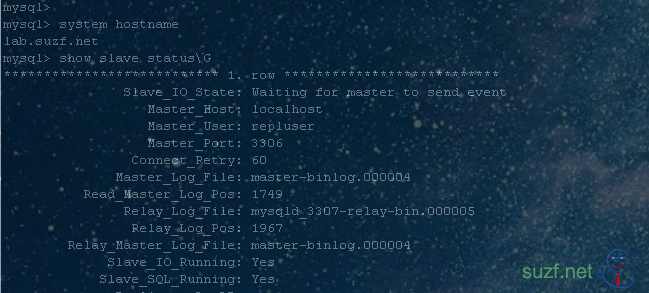
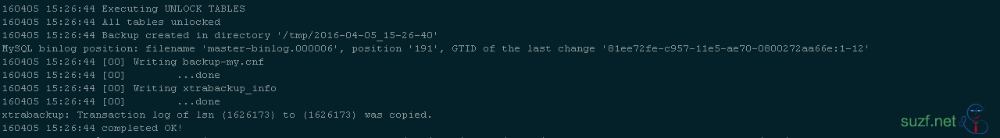

### 准备工作

[Mysql 单机多实例详解](https://suzf.net/zh/blog/posts/mysql-单机多实例详解/)

### 实验环境

Os: CentOS 6.X
Mysql: 5.6 单机多实例 [3306,3307]
Hostname: lab.suzf.net

##### 场景一：新机器 无数据

#####

对于GTID的配置，主要修改配置文件中与GTID特性相关的几个重要参数

<!--more-->

```text
[mysqld_multi]
mysqld = /usr/local/mysql/bin/mysqld_safe
mysqladmin = /usr/local/mysql/bin/mysqladmin
log = /usr/local/mysql/data/log/mysqld_multi.log
user = root ## Used for stopping the server via mysqladmin

# master
[mysqld3306]
socket = /usr/local/mysql/data/run/mysqld_3306.sock
port = 3306
pid-file = /usr/local/mysql/data/run/mysqld_3306.pid
datadir = /usr/local/mysql/data/mysql_3306

# set for GTID Replication
server_id = 3232237894
gtid_mode = on
enforce_gtid_consistency = on  #强制gtid一致性，开启后对于特定create table不被支持

# binlog
log-bin = /usr/local/mysql/data/binlogs/master-binlog
log-slave-updates = 1
binlog_format = row            #强烈建议，其他格式可能造成数据不一致

# rely log
skip_slave_start=1

# slave
[mysqld3307]
socket = /usr/local/mysql/data/run/mysqld_3307.sock
port = 3307
pid-file = /usr/local/mysql/data/run/mysqld_3307.pid
datadir = /usr/local/mysql/data/mysql_3307

# set for GTID Replication
server_id = 3232237866
gtid_mode = on
enforce_gtid_consistency = on

# bin log
log-bin = /usr/local/mysql/data/binlogs/slave-binlog
log-slave-updates = 1
binlog_format = row

# rely log
skip_slave_start=1

[client]
default-character-set = utf8
```
**重启mysql**
/etc/init.d/mysqld\_multi.server restart
**Mysql 多实例启动脚本**
```text
cat /etc/init.d/mysqld_multi.server
#!/bin/sh
#
# A simple startup script for mysqld_multi by Tim Smith and Jani Tolonen.
# This script assumes that my.cnf file exists either in /etc/my.cnf or
# /root/.my.cnf and has groups [mysqld_multi] and [mysqldN]. See the
# mysqld_multi documentation for detailed instructions.
#
# This script can be used as /etc/init.d/mysql.server
#
# Comments to support chkconfig on RedHat Linux
# chkconfig: 2345 64 36
# description: A very fast and reliable SQL database engine.
#
# Version 1.0
#

basedir=/usr/local/mysql
bindir=/usr/local/mysql/bin

conf=$basedir/data/etc/my.cnf
export PATH=$PATH:$bindir

if test -x $bindir/mysqld_multi
then
  mysqld_multi="$bindir/mysqld_multi";
else
  echo "Can't execute $bindir/mysqld_multi from dir $basedir";
  exit;
fi

case "$1" in
    'start' )
        "$mysqld_multi" --defaults-extra-file=$conf start $2
        ;;
    'stop' )
        "$mysqld_multi" --defaults-extra-file=$conf stop $2
        ;;
    'report' )
        "$mysqld_multi" --defaults-extra-file=$conf report $2
        ;;
    'restart' )
        "$mysqld_multi" --defaults-extra-file=$conf stop $2
        "$mysqld_multi" --defaults-extra-file=$conf start $2
        ;;
    *)
        echo "Usage: $0 {start|stop|report|restart}" >&2
        ;;
esac
```
**Master OPS**
```text
mysql -uroot -S /usr/local/mysql/data/run/mysqld_3306.sock
mysql> GRANT REPLICATION SLAVE ON *.* TO 'repluser'@'localhost' IDENTIFIED BY 'suzf.net666';
Query OK, 0 rows affected (0.00 sec)
```
**Slave OPS**
```text
mysql -uroot -S /usr/local/mysql/data/run/mysqld_3307.sock
mysql> CHANGE MASTER TO  
    -> MASTER_HOST='localhost',    
    -> MASTER_USER='repluser',    
    -> MASTER_PASSWORD='suzf.net666',    
    -> MASTER_PORT=3306,    
    -> MASTER_AUTO_POSITION = 1;
Query OK, 0 rows affected, 2 warnings (0.04 sec)
mysql> start slave;
Query OK, 0 rows affected (0.19 sec)
```
验证


#####

##### 场景二：移除  Replication

首先关闭 SLAVE
```text
mysql> STOP SLAVE;
Query OK, 0 rows affected (0.00 sec)
```
使用ALL 参数 重置 SLAVE (MySQL >= 5.6.7):
```text
mysql> RESET SLAVE ALL;
Query OK, 0 rows affected (0.02 sec)
```
此时 mysql replication 已经消失了
```text
mysql> SHOW SLAVE STATUS\G
Empty set (0.00 sec)
```
如果你希望这个SLAVE节点继续做一个新的MASTER的slave 节点，那么请设置 gtid\_purged,你应该发出一下命令（即使 gtid\_puerged 看起来是空的，你也应该重置一下MASTER.）
```text
mysql> reset master;
Query OK, 0 rows affected (0.11 sec)

mysql> show variables like '%gtid%';
+--------------------------+-----------+
| Variable_name            | Value     |
+--------------------------+-----------+
| enforce_gtid_consistency | ON        |
| gtid_executed            |           |
| gtid_mode                | ON        |
| gtid_next                | AUTOMATIC |
| gtid_owned               |           |
| gtid_purged              |           |
+--------------------------+-----------+
6 rows in set (0.00 sec)
```
备注
我很确定我已经删除了 rely-binary-logs. (relay\_log\_basename variable)

##### 场景三：拷贝数据 新建 GTID slave

#### Using mysqldump

在 slave 几点初始化数据库
```text
$ ./scripts/mysql_install_db --datadir=/usr/local/mysql/data/mysql_3307
```
为了更简单使用 mysqldump, 是将下列参数加入配置文件
```text
[mysqldump]
quick
max_allowed_packet = 16M
port = 3306
socket = /usr/local/mysql/data/run/mysqld_3306.sock
```
之后使用下面命令导出 Master 节点的 Cherry 数据库
```text
$ mysqldump --defaults-file=/usr/local/mysql/data/etc/my.cnf --user=root --password=`cat ~mysql/.root_password` --single-transaction --databases Cherry > backup.sql
Warning: Using a password on the command line interface can be insecure.
Warning: A partial dump from a server that has GTIDs will by default include the GTIDs of all transactions, even those that changed suppressed parts of the database. If you don't want to restore GTIDs, pass --set-gtid-purged=OFF. To make a complete dump, pass --all-databases --triggers --routines --events.
```
备注
--defaults-file 参数必须放在第一个位置, 否则你将会入到一个我认为已经修复的 [bug](http://bugs.mysql.com/bug.php?id=31312).
GTID 的诀窍在这里，当然它是通过 mysqldump 来实现的
```text
$grep -i gtid 、/tmp/backup.sql
-- GTID state at the beginning of the backup
SET @@GLOBAL.GTID_PURGED='770d3753-c6e4-11e2-8e78-080027d93e15:1-8';
```
之后将dump 文件传送到 slave 节点，然后导入它；
```text
mysql> source /tmp/backup.sql;
```
我最初得到了下面的错误：
```text
ERROR 1840 (HY000): @@GLOBAL.GTID_PURGED can only be set when @@GLOBAL.GTID_EXECUTED is empty.
```
但是我的 gtid\_executed 参数是空的:
```text
mysql> show variables like '%gtid%';
+--------------------------+------------------------------------------+
| Variable_name            | Value                                    |
+--------------------------+------------------------------------------+
| enforce_gtid_consistency | ON                                       |
| gtid_executed            |                                          |
| gtid_mode                | ON                                       |
| gtid_next                | AUTOMATIC                                |
| gtid_owned               |                                          |
| gtid_purged              | 770d3753-c6e4-11e2-8e78-080027d93e15:1-6 |
+--------------------------+------------------------------------------+
6 rows in set (0.00 sec)
```
错误消息显示冲突 一个[bug](http://bugs.mysql.com/bug.php?id=68038)已经打开。实际上，gtid\_purged也必须是空的，以便能够设置它。[官方文档](http://dev.mysql.com/doc/refman/5.6/en/replication-options-gtids.html)中引用的唯一解决方法是使用下面的命令：
```text
mysql> DROP DATABASE replicationdb;
Query OK, 1 row affected (0.07 sec)

mysql> RESET MASTER;
Query OK, 0 rows affected (0.06 sec)

mysql> SHOW VARIABLES LIKE '%gtid%';
+--------------------------+-----------+
| Variable_name            | Value     |
+--------------------------+-----------+
| enforce_gtid_consistency | ON        |
| gtid_executed            |           |
| gtid_mode                | ON        |
| gtid_next                | AUTOMATIC |
| gtid_owned               |           |
| gtid_purged              |           |
+--------------------------+-----------+
6 rows in set (0.01 sec)
```
一旦完成你可以从新导入备份文件，如果最后没有错误出现，那么现在可以设置 replication 了。
```text
mysql> change master to master_host='lab.suzf.net', master_port=3306, master_user='repluser', master_password='suzf.net666', master_auto_position=1;
Query OK, 0 rows affected, 2 warnings (0.16 sec)

mysql> start slave;
Query OK, 0 rows affected (0.03 sec)

mysql> SHOW SLAVE STATUS\G
*************************** 1. row ***************************

             Slave_IO_Running: Yes
            Slave_SQL_Running: Yes
                ... ...
      Slave_SQL_Running_State: Slave has read all relay log; waiting for the slave I/O thread to update it
```
如果使用的是mysql 5.5 可能会用到
```text
change master to master_host='lab.suzf.net', master_port=3306, master_user='repluser', master_password='suzf.net666',  master_log_file='mysql-bin.000006', master_log_pos=1026;
```
从哪里可以获得 master\_log\_file 和 log\_position（在你导入数据时请不要将 master 设置为 read-only ）
```text
mysql> FLUSH TABLES WITH READ LOCK;
mysql> SHOW MASTER STATUS;
```

#### Using XtraBackup

准备工作
```text
$mkdir  /opt/data/backup/mysql -p
$ cat 3306.cnf
[mysqld]
socket = /usr/local/mysql/data/run/mysqld_3306.sock
port = 3306
pid-file = /usr/local/mysql/data/run/mysqld_3306.pid
datadir = /usr/local/mysql/data/mysql_3306

# set for GTID Replication
server_id = 3232237894
gtid_mode = on
enforce_gtid_consistency = on

# binlog
log-bin = /usr/local/mysql/data/binlogs/master-binlog
log-slave-updates = 1
binlog_format = row

# rely log
skip_slave_start=1

[client]
default-character-set = utf8

$ cat 3307.cnf
[mysqld]
socket = /usr/local/mysql/data/run/mysqld_3307.sock
port = 3307
pid-file = /usr/local/mysql/data/run/mysqld_3307.pid
datadir = /usr/local/mysql/data/mysql_3307

# set for GTID Replication
server_id = 3232237866
gtid_mode = on
enforce_gtid_consistency = on

# bin log
log-bin = /usr/local/mysql/data/binlogs/slave-binlog
log-slave-updates = 1
binlog_format = row

# rely log
skip_slave_start=1

[client]
default-character-set = utf8
```
我们将使用下面命令完整数据库备份：
```text
$innobackupex --defaults-file=/opt/data/backup/mysql/3306.cnf --user=root  --socket=/usr/local/mysql/data/run/mysqld_3306.sock  /tmp
```

这里要注意的重要的文件是在xtrabackup\_binlog\_info
```text
$ cat /tmp/2016-04-05_15-26-40/xtrabackup_binlog_info
master-binlog.000006  191 81ee72fe-c957-11e5-ae70-0800272aa66e:1-12
```
在 Slave 节点恢复数据
```text
$ innobackupex --defaults-file=/opt/data/backup/mysql/3307.cnf --user=root  --copy-back /tmp/2016-04-05_15-26-40
```
备注
Original data directory must be empty!
即 Slave 节点数据目录必须为空
权限修复 启动实例
```text
$ chown -R mysql:mysql  /usr/local/mysql/data/mysql_3307
$ /etc/init.d/mysqld_multi.server start 3307
$ /etc/init.d/mysqld_multi.server report
Reporting MySQL servers
MySQL server from group: mysqld3306 is running
MySQL server from group: mysqld3307 is running
```
你需要先设置 gtid\_purged 然后再创建 replication，在 [Percona 文档](https://www.percona.com/doc/percona-xtrabackup/2.1/howtos/recipes_ibkx_gtid.html) 中有说明
```text
mysql>  SET GLOBAL gtid_purged="81ee72fe-c957-11e5-ae70-0800272aa66e:1-12";
ERROR 1840 (HY000): @@GLOBAL.GTID_PURGED can only be set when @@GLOBAL.GTID_EXECUTED is empty.

# 出现上面个错误 执行下面操作
mysql> reset master;
Query OK, 0 rows affected (0.02 sec)

mysql>  SET GLOBAL gtid_purged="81ee72fe-c957-11e5-ae70-0800272aa66e:1-12";
Query OK, 0 rows affected (0.05 sec)

mysql> CHANGE MASTER TO  
    -> MASTER_HOST='localhost',    
    -> MASTER_USER='repluser',    
    -> MASTER_PASSWORD='suzf.net666',    
    -> MASTER_PORT=3306,    
    -> MASTER_AUTO_POSITION = 1;
Query OK, 0 rows affected, 2 warnings (0.06 sec)

mysql> SHOW WARNINGS;
+-------+------+--------------------------------------------------------------------------------------------------------------------------------------------------------------------------------------------------------------------------------------------------------------------------------------+
| Level | Code | Message                                                                                                                                                                                                                                                                              |
+-------+------+--------------------------------------------------------------------------------------------------------------------------------------------------------------------------------------------------------------------------------------------------------------------------------------+
| Note  | 1759 | Sending passwords in plain text without SSL/TLS is extremely insecure.                                                                                                                                                                                                               |
| Note  | 1760 | Storing MySQL user name or password information in the master info repository is not secure and is therefore not recommended. Please consider using the USER and PASSWORD connection options for START SLAVE; see the 'START SLAVE Syntax' in the MySQL Manual for more information. |
+-------+------+--------------------------------------------------------------------------------------------------------------------------------------------------------------------------------------------------------------------------------------------------------------------------------------+
2 rows in set (0.00 sec)
```
在经典的复制中（MySQL的5.5及以下）命令应该是这样的：
```text
change master to master_host='lab.suzf.net', master_port=3306, master_user='repluser', master_password='suzf.net666',  master_log_file='mysql-bin.000006', master_log_pos=1026;
```
启动 slave 查看状态
```text
mysql> start slave;
Query OK, 0 rows affected (0.01 sec)

mysql> show slave status\G
             Slave_IO_Running: Yes
            Slave_SQL_Running: Yes
      Slave_SQL_Running_State: Slave has read all relay log; waiting for the slave I/O thread to update it
           Retrieved_Gtid_Set: 81ee72fe-c957-11e5-ae70-0800272aa66e:13
            Executed_Gtid_Set: 81ee72fe-c957-11e5-ae70-0800272aa66e:1-13
                Auto_Position: 1
```

##### 场景四：经典复制 --> GTID Replication

a. 按场景一中描述配置参数文件
b. 所有服务器设置global.read\_only参数，等待主从服务器同步完毕；
mysql> SET @@global.read\_only = ON;
c. 依次重启主从服务器；
d. 使用change master 更新主从配置；
mysql> CHANGE MASTER TO
> MASTER\_HOST = host,
> MASTER\_PORT = port,
> MASTER\_USER = user,
> MASTER\_PASSWORD = password,
> MASTER\_AUTO\_POSITION = 1;
e. 从库开启复制
mysql> START SLAVE;
f. 验证主从复制

#####

### FAQ

### Skip counter with GTID

```text
mysql> show slave status\G
*************************** 1. row ***************************
           Retrieved_Gtid_Set: 770d3753-c6e4-11e2-8e78-080027d93e15:1-9
            Executed_Gtid_Set: 770d3753-c6e4-11e2-8e78-080027d93e15:1-7,
97e23f6a-cc52-11e2-b1e1-08002776e125:1-2
                Auto_Position: 1
1 row in set (0.00 sec)
```
从上面我们可以猜测到 事务执行到 事务ID 8 可能出现错误，接下来我们需要注入相同的空事务ID。
```text
mysql> stop slave;
Query OK, 0 rows affected (0.00 sec)

mysql> show variables like '%gtid%';
+--------------------------+-----------+
| Variable_name            | Value     |
+--------------------------+-----------+
| enforce_gtid_consistency | ON        |
| gtid_executed            |           |
| gtid_mode                | ON        |
| gtid_next                | AUTOMATIC |
| gtid_owned               |           |
| gtid_purged              |           |
+--------------------------+-----------+
6 rows in set (0.00 sec)

mysql> set gtid_next='770d3753-c6e4-11e2-8e78-080027d93e15:8';
Query OK, 0 rows affected (0.00 sec)

mysql> begin;
Query OK, 0 rows affected (0.00 sec)

mysql> commit;
Query OK, 0 rows affected (0.00 sec)

mysql> set gtid_next='AUTOMATIC';
Query OK, 0 rows affected (0.00 sec)

mysql> start slave;
Query OK, 0 rows affected (0.00 sec)
```
 
Reference : [Mysql manual](https://dev.mysql.com/doc/refman/5.6/en/replication-gtids.html)
