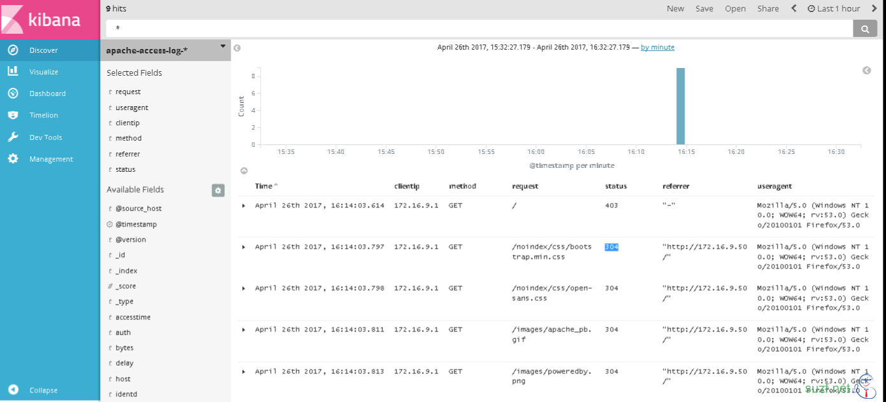

## Introduction

The goal here is to turn Apache access logs into JSON and store them in Elasticsearch, so the ELK stack can analyze them. Most distributions ship rsyslog by default, but it is still worth getting the latest stable version from the [rsyslog repositories](http://www.rsyslog.com/downloads/download-other/). You will need these packages:

- rsyslog-mmnormalize. This gives you [mmnormalize](http://www.rsyslog.com/doc/master/configuration/modules/mmnormalize.html), a module that will do the parsing of common Apache logs to JSON
- rsyslog-elasticsearch, for the [Elasticsearch output](http://www.rsyslog.com/doc/master/configuration/modules/omelasticsearch.html)

The steps are:

1. Load the modules you need
2. Send the Apache logs to the central log server
3. Configure the main queue to buffer your messages. This is also where you set the number of worker threads and the batch size (which is also the Elasticsearch bulk size)
4. Parse the Apache logs into JSON
5. Define a template that sets the format of the JSON messages, and use it with the Elasticsearch output to send the logs to Elasticsearch / Logstash

<!--more-->

### Load the modules

```
# The imjournal module bellow is now used as a message source instead of imuxsock.
$ModLoad imuxsock  # provides support for local system logging (e.g. via logger command)
$ModLoad imjournal # provides access to the systemd journal
$ModLoad imklog    # reads kernel messages (the same are read from journald)
$ModLoad immark    # provides --MARK-- message capability

# Provides UDP syslog reception
$ModLoad imudp
$UDPServerRun 514

# Provides File syslog reception
# $ModLoad imfile

# Provides parser syslog reception
$ModLoad mmnormalize

# Elasticsearch output module
$ModLoad omelasticsearch
```

### Log input

```
cat >> /etc/rsyslog.conf << EOF
# Send all log to logserver
*.* @log.suzf.net:514
EOF
```

Then restart rsyslog on the web server so the Apache access log goes to the central log server. You could also ship the log file with rsyslog's imfile module; I skip that here.

### Queue and workers

By default, every incoming message goes to the main queue. You can define more queues with [rulesets](http://www.rsyslog.com/doc/master/concepts/multi_ruleset.html), split by category, but let's keep it simple:

```
main_queue(
  queue.workerThreads="4"
  queue.dequeueBatchSize="1000"
  queue.highWatermark="500000"    # max no. of events to hold in memory
  queue.lowWatermark="200000"     # use memory queue again, when it's back to this level
  queue.spoolDirectory="/var/run/rsyslog/queues"  # where to write on disk
  queue.fileName="stats_ruleset"
  queue.maxDiskSpace="5g"        # it will stop at this much disk space
  queue.size="5000000"           # or this many messages
  queue.saveOnShutdown="on"      # save memory queue contents to disk when rsyslog is exiting
)
```

### Parse the logs with mmnormalize

mmnormalize does its parsing with [liblognorm](https://github.com/rsyslog/liblognorm/blob/master/doc/introduction.rst), so in the configuration you only point it at a liblognorm rulebase:

```
action(type="mmnormalize" 
    ruleBase="/etc/rsyslog.d/apache_access_log.rule")
```

apache\_access\_log.rule holds the rule for parsing Apache logs, shown below. The exact rule depends on the log format you defined in Apache.

```
# cat /etc/rsyslog.d/apache_access_log.rule
version=2
# prefix=%rcvdat:date-rfc5424% %rcvdfrom:word% %tag:word%
rule=:%clientip:word% %delay:word% %identd:word% %auth:word% [%accesstime:char-to:]%] "%method:word% %request:word% %pversion:char-to:"%" %status:word% %bytesend:word% %referer:word% %useragent:quoted-string%
```

See the [liblognorm documentation](https://github.com/rsyslog/liblognorm/blob/master/doc/configuration.rst) for the rule syntax. A new rule rarely works on the first try. To check it for errors, use **lognormalizer** (`yum install -y liblognorm-utils`):

```
head -1 /path/to/log.file | /usr/lib/lognorm/lognormalizer -r /path/to/rulebase.rb -e json
```

For example:

```
# cat test_msg
172.16.9.1 241 - - [26/Apr/2017:11:31:48 +0800] "GET /images/apache_pb.gif HTTP/1.1" 304 - "-" "Mozilla/5.0 (Windows NT 10.0; WOW64; rv:53.0) Gecko/20100101 Firefox/53.0"
# head -1 test_msg | lognormalizer  -r /etc/rsyslog.d/apache_access_log.rule -e json
{"useragent": "Mozilla/5.0 (Windows NT 10.0; WOW64; rv:53.0) Gecko/20100101 Firefox/53.0", "referer": "\"-\"", "bytes": "-", "status": "304", "pversion": "HTTP/1.1", "request": "/images/apache_pb.gif", "method": "GET", "accesstime": "26/Apr/2017:11:31:48 +0800", "auth": "-", "identd": "-", "delay": "241", "clientip": "172.16.9.1"}
```

Note: anything the rule cannot parse ends up in `unparsed-data`.

### Time-based indices in your own Elasticsearch cluster

```
# this is for index names to be like: apache-access-log-YYYY.MM.DD
template(name="apache-access-log-index" type="list") {
    constant(value="apache-access-log-")
    property(name="timereported" dateFormat="rfc3339" position.from="1" position.to="4")
    constant(value=".")
    property(name="timereported" dateFormat="rfc3339" position.from="6" position.to="7")
    constant(value=".")
    property(name="timereported" dateFormat="rfc3339" position.from="9" position.to="10")
}
```

### Templates

```
template(name="WebFiles" type="string" string="/var/log/web/httpd/access_%$!vhost%.log")
template(name="apache-access-log" type="list" option.json="on") {
        constant(value="{")
        constant(value="\"@version\":\"0.0.1\", ")
        constant(value="\"@timestamp\":\"")             property(name="timereported" dateFormat="rfc3339")
        constant(value="\",\"message\":\"")             property(name="msg" position.from="1" spifno1stsp="off")
        constant(value="\",\"host\":\"")                property(name="fromhost-ip")
        constant(value="\",\"@source_host\":\"")        property(name="hostname")
        constant(value="\",\"tag\":\"")                 property(name="syslogtag")
        constant(value="\",\"clientip\":\"")            property(name="$!clientip")
        constant(value="\",\"delay\":\"")               property(name="$!delay")
        constant(value="\",\"identd\":\"")              property(name="$!identd")
        constant(value="\",\"auth\":\"")                property(name="$!auth")
        constant(value="\",\"accesstime\":\"")         property(name="$!accesstime")
        constant(value="\",\"method\":\"")              property(name="$!method")
        constant(value="\",\"request\":\"")             property(name="$!request")
        constant(value="\",\"pversion\":\"")            property(name="$!pversion")
        constant(value="\",\"status\":\"")              property(name="$!status")
        constant(value="\",\"bytes\":\"")               property(name="$!bytes")
        constant(value="\",\"referrer\":\"")            property(name="$!referer")
        constant(value="\",\"useragent\":\"")           property(name="$!useragent")
        constant(value="\"}")
}

# If you’re using rsyslog only for parsing Apache logs (and not system logs)
# and send your logs to Logsene, this bit is rather simple.
# Because by the time parsing ended, you already have all the relevant fields in the $!all-json variable,
# that you’ll use as a template:

template(name="all-json" type="list"){
  property(name="$!all-json")
}
```

### Actions

```
if $programname == 'access_test' then {
    action(type="mmnormalize" ruleBase="/etc/rsyslog.d/apache_access_log.rule")
    if $parsesuccess == "OK" then {         
              action(type="omfile" DynaFile="WebFiles" template="apache-access-log" DirCreateMode="0755" FileCreateMode="0644")
              action(type="omelasticsearch"
                        server="172.16.9.50"
                        serverport="9200"
                        template="apache-access-log"
                        # template="all-json"
                        searchIndex="apache-access-log-index"
                        dynSearchIndex="on"
                        searchType="events"
                        bulkmode="on"
                        queue.type="linkedlist"
                        queue.size="5000"
                        queue.dequeuebatchsize="300"
                        action.resumeretrycount="-1"
                        errorFile="/var/log/omelasticsearch22.log")
        stop
    }
}
```

All of the configuration above lives in `/etc/rsyslog.conf`. Restart rsyslog, check that it prints no errors, then create the index pattern in Kibana and check the result:



> This setup was written for rsyslog 8 and Elasticsearch 5. Newer Elasticsearch versions have dropped mapping types, so leave out `searchType` there.

References

[0] http://www.liblognorm.com/files/manual/index.html

[1] http://httpd.apache.org/docs/current/mod/mod\_log\_config.html

[2] http://www.rsyslog.com/rsyslog-and-elasticsearch/

[3] https://linux-help.org/wiki/logging/rsyslog/advanced-rsyslog

[4] http://www.rsyslog.com/log-normalization-for-different-formats/

[5] https://techpunch.co.uk/development/how-to-ship-logs-with-rsyslog-and-logstash

[6] http://www.rsyslog.com/tag/liblognorm/
